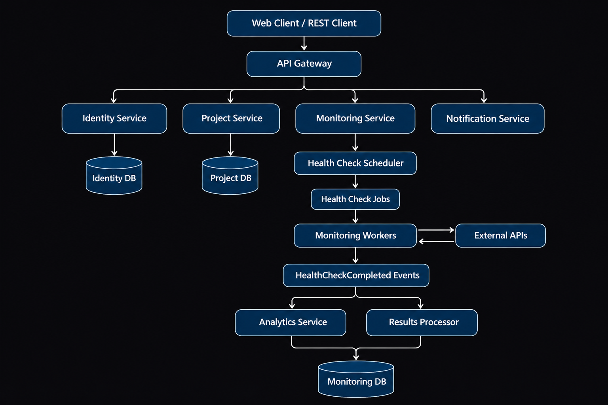

# ApiFlow

ApiFlow is an API monitoring platform built with **Java and Spring Boot**, using a microservices architecture.

The platform allows users to register applications, configure health checks, monitor API availability and response times, and receive notifications when services become unavailable.

> **Status:** Under development.

## Architecture



## Features

- User authentication and authorization
- Organization and project management
- Application and health endpoint registration
- Automated health checks
- API availability and response time monitoring
- Event-driven communication with Apache Kafka
- Email and Discord notifications
- Monitoring history and analytics

## Tech Stack

- Java 21
- Spring Boot
- Spring Security
- Spring Cloud Gateway
- Apache Kafka
- PostgreSQL
- Docker

## Project Structure

```text
api-flow/
├── identity-service/
├── project-service/
├── monitoring-service/
├── monitoring-worker/
├── notification-service/
├── api-gateway/
└── docs/
    └── architecture.png
```

## About

This project is being developed as a portfolio project to explore microservices, distributed systems, asynchronous messaging, and backend development best practices.